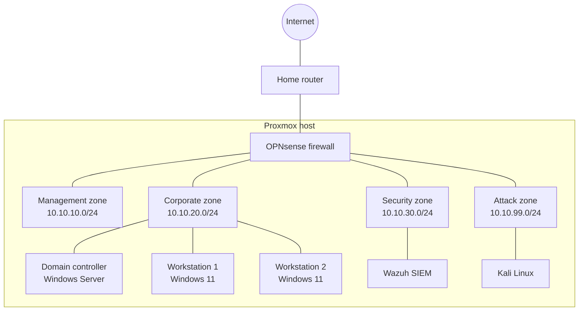

# Cybersecurity Homelab

A virtualized corporate network that I build, secure, monitor, attack, and document, end to end. The goal is hands-on experience across the full security lifecycle: infrastructure, identity, detection, hardening, offensive testing, and governance.

Every phase is defined in code where possible and comes with a written report in [`writeups/`](writeups/).

> **Status:** Phase 0 (planning) in progress. Building starts late November 2026.

---

## Architecture

The lab runs on a dedicated Proxmox host. All lab traffic stays on internal virtual networks, routed and filtered by an OPNsense firewall, so nothing in the lab touches my home network directly.



*Addressing is the planned layout and will be updated as the lab is built.*

## Hardware

| Component | Spec |
|---|---|
| CPU | AMD Threadripper 1950X (16 cores / 32 threads) |
| Motherboard | ASUS PRIME X399-A |
| RAM | 32 GB DDR4, quad-channel |
| VM storage | NVMe SSD |
| Bulk storage | 4 TB HDD (ISOs, backups) |
| Hypervisor | Proxmox VE |

## Roadmap

- [ ] **Phase 0: Plan.** Lab design, network diagram, repository setup
- [ ] **Phase 1: Foundation.** Proxmox host, infrastructure as code with Terraform and Ansible
- [ ] **Phase 2: Network.** OPNsense firewall with segmented zones and Suricata IDS
- [ ] **Phase 3: Identity.** Active Directory domain, Windows clients, Group Policy, Entra ID with MFA
- [ ] **Phase 4: Detection.** Wazuh SIEM collecting Sysmon, Windows, Linux, and firewall logs
- [ ] **Phase 5: Hardening.** CIS Benchmarks, plus vulnerability scans before and after
- [ ] **Phase 6: Attack.** Atomic Red Team simulations mapped to MITRE ATT&CK, with a detection coverage report
- [ ] **Phase 7: Governance.** Security policies, risk assessment, incident response plan, tabletop exercise
- [ ] **Phase 8: Extras.** A cloud security component and a Python security tool

## Repository layout

```
homelab/
├── README.md          Project overview (this file)
├── diagrams/          Network and architecture diagrams
├── infrastructure/    Terraform and Ansible code
├── writeups/          One report per phase
└── policies/          Phase 7 governance documents
```

## Writeups

| Phase | Report |
|---|---|
| 1. Foundation | *Coming soon* |

## Skills demonstrated

Virtualization (Proxmox) · Infrastructure as code (Terraform, Ansible) · Network segmentation and firewalls (OPNsense, VLANs) · Intrusion detection (Suricata) · Active Directory and Group Policy · SIEM and log analysis (Wazuh, Sysmon) · Detection engineering · Vulnerability management · Adversary simulation (MITRE ATT&CK) · Security governance (NIST CSF)

---

*This is a personal lab built for learning. All offensive testing is performed only against systems I own, inside an isolated network.*
